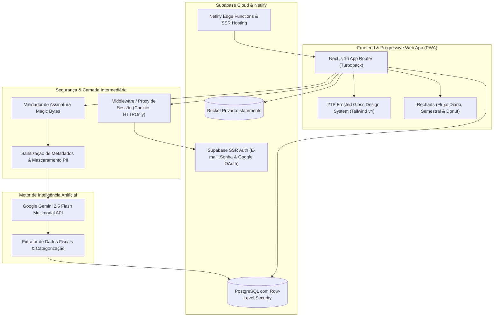

# 🔥 Nexo Finance — Gestão Financeira Inteligente com IA

> **SaaS de Controle Financeiro Pessoal Executivo com Leitura de Comprovantes por IA (Gemini 2.5 Flash), Cartões de Crédito, Envelopes Orçamentários e Previsão Preditiva.**  
> Desenvolvido sob o ecossistema **2TP Soluções em Tecnologia** com a linguagem visual **Frosted Glass 2TP (Apple VisionOS inspired)**.

---

## 🌐 Acesso em Produção

- 🚀 **Aplicação Web Oficial:** [https://nexo-finance-oimw.netlify.app](https://nexo-finance-oimw.netlify.app)
- 🎨 **Design System Studio:** [https://nexo-finance-oimw.netlify.app/design-system](https://nexo-finance-oimw.netlify.app/design-system)
- 📦 **Repositório GitHub:** [https://github.com/thiago-castr0/Nexo-finance](https://github.com/thiago-castr0/Nexo-finance)

---

## 🏗️ Arquitetura da Solução



---

## 🌟 Principais Recursos

### 1. 🤖 Auditoria e Leitura de Comprovantes com IA Real (Gemini 2.5 Flash)
- Upload de notas fiscais, faturas e recibos em **PDF, PNG ou JPG**.
- Validação instantânea de **Magic Bytes** no cliente e servidor, rejeitando arquivos executáveis maliciosos disfarçados.
- Mascaramento rigoroso de **PII (CPF e números de cartão de crédito)** antes do envio aos modelos de linguagem.
- Extração precisa de valor, data, descrição e classificação automática em uma das 10 categorias canônicas.
- **Visualizador de Cupom Digital:** Inspecione a qualquer momento o comprovante anexado ou a auditoria da IA diretamente pelo extrato.

### 2. 💳 Cartões de Crédito & Compras Parceladas (1x a 24x)
- Cadastro de cartões com bandeira, limites, dia de fechamento e dia de vencimento.
- Visual em vidro temperado com cálculo dinâmico do limite disponível e fatura do mês ativo.
- Suporte a compras parceladas com **geração preditiva em lote** para as faturas dos meses subsequentes.

### 3. 🎯 Metas Financeiras & Cofrinhos de Poupança (Savings Goals)
- Criação de objetivos financeiros (Reserva de Emergência, Viagem, etc.) com cores personalizadas e data-alvo.
- **Previsão Preditiva:** Cálculo em tempo real de **quantos meses faltam** para conquistar o objetivo baseando-se na capacidade mensal de economia (receitas − despesas).
- Aportes e resgates reativos com persistência segura no Postgres com RLS.

### 4. ✉️ Envelopes Orçamentários com Persistência em Nuvem
- Definição de limites de gastos por categoria persistidos na tabela `public.category_budgets` no Supabase Cloud.
- Alertas visuais automáticos: **Atenção (80%)** e **Estouro Orçamentário (100%)**.

### 5. 📈 Central Gráfica & Analítica (Recharts)
- **Fluxo de Caixa:** Alternância entre **Área com Gradiente Suave** e **Barras Verticais**, com visão **Diária** (mês atual) ou **Semestral** (histórico de 6 meses).
- **Gráfico Donut de Despesas:** Distribuição percentual por categoria com centro inteligente e ranking lateral com sincronização de foco.

### 6. 🔎 Central de Busca e Filtros Avançados no Extrato
- Busca por texto, estabelecimento, categoria ou valor numérico com limpeza rápida.
- Filtros multi-critério: Categoria, Cartão de Crédito/Conta Corrente, Origem (IA, Fixas, Parceladas).
- Ordenação dinâmica (data mais recente/antiga, maior/menor valor, ordem alfabética).
- Chips removíveis com 1 clique e mini-sumário financeiro instantâneo.

### 7. 📱 Progressive Web App (PWA) & Mobile First
- Pronto para **"Adicionar à Tela Inicial"** no iOS e Android, operando como aplicativo nativo.
- Ergonomia tátil com alvos mínimos de toque de 44x44px e navegação inferior dedicada.

---

## 🛠️ Stack Tecnológica

| Camada | Tecnologia |
| :--- | :--- |
| **Framework Web** | [Next.js 16](https://nextjs.org/) (App Router + Turbopack) |
| **Linguagem** | [TypeScript 5](https://www.typescriptlang.org/) (Strict Mode) |
| **Estilização** | [Tailwind CSS v4](https://tailwindcss.com/) + CSS Variables semânticas 2TP |
| **Gráficos** | [Recharts](https://recharts.org/) |
| **Inteligência Artificial** | [Google Gemini 2.5 Flash](https://ai.google.dev/) Multimodal API |
| **Banco de Dados** | [PostgreSQL (Supabase Cloud)](https://supabase.com/) |
| **Autenticação** | Supabase SSR Auth com cookies seguros HTTPOnly & Google OAuth |
| **Storage de Arquivos** | Supabase Storage (Bucket privado `statements`) |
| **Hospedagem & CDN** | [Netlify](https://www.netlify.com/) (Deploy contínuo via GitHub) |
| **Testes Unitários** | Node.js Test Runner nativo (`node:test` e `node:assert/strict`) |

---

## 🚀 Como Executar Localmente

### Pré-requisitos
- Node.js 20+ ou 22+
- Chave de API do Supabase e Gemini

### 1. Clonar o Repositório
```bash
git clone https://github.com/thiago-castr0/Nexo-finance.git
cd Nexo-finance
```

### 2. Instalar Dependências
```bash
npm install
```

### 3. Configurar Variáveis de Ambiente
Crie um arquivo `.env.local` na raiz com:
```env
NEXT_PUBLIC_SUPABASE_URL=https://sua-url.supabase.co
NEXT_PUBLIC_SUPABASE_ANON_KEY=sua-chave-anonima
GEMINI_API_KEY=sua-chave-gemini-ai
```

### 4. Executar Testes Automatizados
```bash
npm test
```

### 5. Iniciar o Servidor de Desenvolvimento
```bash
npm run dev
```
Acesse [http://localhost:3000](http://localhost:3000) no seu navegador.

---

## 📋 Qualidade e Cobertura de Código

- ✅ **9/9 Testes Unitários Aprovados** (Cálculo de ponto flutuante financeiro, sanitização de comprovantes, magic bytes, Donut Chart, schemas de envelopes e comprovantes).
- ✅ **0 Erros de TypeScript** (`npx tsc --noEmit`).
- ✅ **0 Warnings no ESLint** (`npm run lint`).
- ✅ **Build de Produção Turbopack 100% Otimizado**.

---

## 📄 Licença e Direitos

Projeto desenvolvido sob o ecossistema de soluções digitais da **2TP Soluções em Tecnologia**.  
Todos os direitos reservados © 2026.
