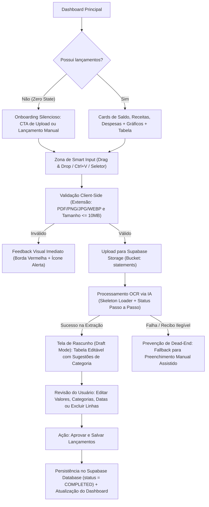

# 🗺️ Mapeamento de Fluxos de Usuário, Heurísticas e Matriz de Borda (Card 1.2)

**Responsáveis:** `@AgentePO` (`POE-002`), `@AgenteUX` (`skill_user_flows.md`, `skill_ux_heuristics.md`), `@AgenteQA` (`QAE-003`)

---

## 1. Arquitetura da Jornada Principal (Smart Input -> Rascunho -> Aprovação)



---

## 2. Detalhamento dos Fluxos de Tela (`@AgenteUX`)

### 2.1. Fluxo 1: Dashboard & Onboarding Silencioso (Zero State)
- **Zero State:** Quando o usuário ainda não possui transações, exibir um card central clean (`1px solid`, cantos `rounded-xl`) com ícone Lucide `FileSpreadsheet` (`strokeWidth={1.5}`), mensagem acolhedora e dois botões *Outline*:
  1. **"Enviar primeiro extrato ou comprovante (IA)"** (Destaque Primário Vermelho/Roxo)
  2. **"Adicionar lançamento manual"** (Ação Secundária)
- **Atalho Global sem Fricção:** Em qualquer momento no Dashboard, o usuário pode arrastar um arquivo (Drag & Drop) ou pressionar `Ctrl+V` para colar um print de comprovante PIX/extrato diretamente na tela.

### 2.2. Fluxo 2: Upload & Processamento Inteligente (Smart Input)
- **Visibilidade do Status do Sistema (Heurística #1 de Nielsen):**
  - Etapa 1: *"Validando e protegendo seu documento..."*
  - Etapa 2: *"Armazenando com segurança..."*
  - Etapa 3: *"Nossa IA está lendo os lançamentos e categorizando despesas..."*
- **Prevenção de Dead-Ends:** Se o arquivo estiver ilegível, corrompido ou a API de IA exceder o timeout (15s), exibir alerta amigável: *"Não conseguimos extrair os dados automaticamente deste arquivo. Deseja preencher manualmente com o comprovante ao lado?"* com botão direto para o formulário manual.

### 2.3. Fluxo 3: Tela de Rascunho (Draft Review) — Regra de Ouro `BKE-003`
- **Nenhum dado da IA vai direto como definitivo para o saldo:** Todos os itens extraídos abrem no painel de **Rascunho (Draft)**.
- **Reconhecimento em vez de Lembrança (Heurística #6):** Cada linha já traz a categoria sugerida pela IA (ex: *Alimentação*, *Transporte*, *Moradia*, *Salário*) com badge colorido e ícone Lucide correspondente.
- **Controle e Liberdade (Heurística #3):**
  - Edição inline rápida via teclado (`Tab` entre Descrição -> Data -> Categoria -> Tipo -> Valor com `tabular-nums`).
  - Botão para remover item espúrio ou restaurar valores originais lidos pela IA (*Desfazer alterações*).
  - Resumo no rodapé do Rascunho mostrando: **Total de Entradas (Verde)**, **Total de Saídas (Vermelho)** e **Impacto Líquido no Saldo** antes da confirmação.

### 2.4. Fluxo 4: Lançamento Manual Rápido (Keyboard-First)
- Formulário enxuto acessível via tecla de atalho ou botão *Outline* `"Novo Lançamento"`.
- Ordem de tabulação (`Tab`): Tipo (`Saída` / `Entrada`) -> Descrição -> Valor (`tabular-nums`) -> Data (padrão: Hoje) -> Categoria -> `Enter` para salvar.

---

## 3. Matriz de Cenários de Borda — Edge Cases (`@AgenteQA` - `QAE-003`)

| ID | Cenário Adverso (Lei de Murphy) | Camada de Defesa | Comportamento Esperado do Sistema |
| :--- | :--- | :--- | :--- |
| **EC-01** | Upload de arquivo > 10MB (ex: PDF de 50MB) | Client-Side (`FTE-004`) & Storage (`BKE-004`) | Bloqueio imediato antes do upload com alerta: *"Arquivo excede o limite de 10MB."* |
| **EC-02** | Arquivo `.exe` ou `.bat` renomeado para `.pdf` | Server-Side Magic Bytes (`BKE-004` / `SEC-001`) | Rejeição no servidor via verificação da assinatura binária (`%PDF-`, `PNG`, `JFIF`). |
| **EC-03** | PDF protegido por senha ou em branco | Motor OCR (`BKE-003`) | Captura graciosa do erro e redirecionamento para o fluxo de preenchimento manual. |
| **EC-04** | Imagem PNG/JPG muito escura ou cortada | Motor OCR (`BKE-003`) | IA retorna lista vazia ou baixa confiança; UI avisa o usuário e abre modo manual. |
| **EC-05** | IA retorna JSON com blocos markdown (`` ```json ``) ou texto extra | Parser Backend (`BKE-003` / `QAE-002`) | Sanitização via regex e validação estrita com schema `Zod` antes de devolver ao Frontend. |
| **EC-06** | Queda de conexão durante a aprovação do Rascunho | State Management (`FTE-002` / `FTE-003`) | Preserva os dados do rascunho em estado local para não perder edições e exibe Toast de re-tentativa. |
| **EC-07** | Erros de arredondamento IEEE 754 (ex: `0.1 + 0.2`) | Utilitário Financeiro (`QAE-002`) | Cálculos normalizados em centavos (inteiros) ou arredondamento estrito de 2 casas decimais. |

---

## 4. Critérios de Aceite (`@AgentePO` - `POE-002`)

1. **CA-01 (Upload & Validação):** *Dado* que o usuário seleciona, arrasta ou cola (`Ctrl+V`) um arquivo no Dashboard, *Quando* o arquivo for PDF, PNG, JPG ou WEBP com até 10MB, *Então* o sistema deve iniciar o processamento exibindo feedback visual de progresso.
2. **CA-02 (Revisão Obrigatória em Rascunho):** *Dado* que a IA extraiu transações de um documento, *Quando* o processamento terminar, *Então* os lançamentos devem ser exibidos na Tela de Rascunho (Draft) permitindo editar descrição, valor, data, tipo e categoria, ou excluir linhas antes de salvar.
3. **CA-03 (Aprovação e Atualização de Saldo):** *Dado* que o usuário revisou os itens na Tela de Rascunho, *Quando* clicar em `"Aprovar Lançamentos"`, *Então* as transações devem ser salvas como concluídas e os cards de Saldo Total, Receitas, Despesas e gráficos do Dashboard devem refletir os novos valores imediatamente.
4. **CA-04 (Fallback sem Beco sem Saída):** *Dado* que o documento enviado está ilegível ou falhou na leitura automática, *Quando* o motor retornar erro, *Então* a interface deve informar o motivo de forma clara (ícone + texto) e oferecer abertura imediata do formulário manual.
